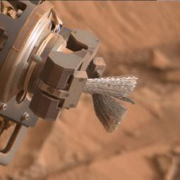
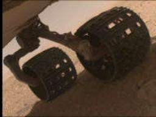
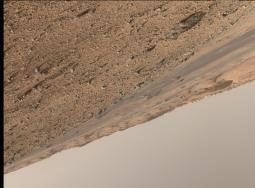
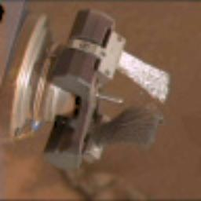

# Mars Curiosity Rover Image Classifier

A multi-page **Streamlit** computer vision application powered by a fine-tuned **PyTorch `ResNet-18`** model to classify NASA Mars Science Laboratory (Curiosity) rover and surface images across **20 classes**.

---

## Highlights & Performance

* **Model Backbone:** Fine-tuned `ResNet-18` (`224 × 224` RGB input, ImageNet normalization) trained over **10 epochs**.
* **Dataset:** `RAAArity/Mars_surface_image_Curiosity_rover_labeled_data_set_version_1` (~61 MB, 20 MSL Curiosity surface & hardware classes with strong class imbalance).
* **Evaluation Metrics:**
  * **Best Validation Macro F1:** `0.6996` (Epoch 10)
  * **Test Accuracy:** `0.7372`
  * **Test Macro F1:** `0.6395`
  * **Test Weighted F1:** `0.7432`
* **Interactive Multi-Page App:** Shared sidebar (`sidebar.py`) with `@st.cache_resource` model caching, project overview, live classifier with optional ground-truth label verification, dataset explorer, and model evaluation summary.

---

## Saved Test Sample Images (`outputs/gradio_examples/`)

| `outputs/gradio_examples/test_sample_0.jpg` | `outputs/gradio_examples/test_sample_1.jpg` |
| :---: | :---: |
| [cite: 5, 6] | [cite: 5, 6] |

| `outputs/gradio_examples/test_sample_2.jpg` | `outputs/gradio_examples/test_sample_3.jpg` |
| :---: | :---: |
| [cite: 5, 6] | [cite: 5, 6] |

---

## Training Class Distribution (20 Classes)

| Class ID | Category | Train Count | Class ID | Category | Train Count |
| :---: | :--- | :---: | :---: | :--- | :---: |
| `00` | `apxs` | 30 | `10` | `inlet` | 165 |
| `01` | `apxs cal target` | 6 | `11` | `mahli` | 14 |
| `02` | `chemcam cal target` | 15 | `12` | `mahli cal target` | 32 |
| `03` | `chemin inlet open` | 47 | `13` | `mastcam` | 36 |
| `04` | `drill` | 19 | `14` | `mastcam cal target` | 101 |
| `05` | `drill holes` | 36 | `15` | `observation tray` | 85 |
| `06` | `drt front` | 4 | `16` | `portion box` | 18 |
| `07` | `drt side` | 8 | `17` | `portion tube` | 73 |
| `08` | `ground` | 2343 | `18` | `portion tube opening` | 8 |
| `09` | `horizon` | 224 | `19` | `rems uv sensor` | 12 |

---

## Project Structure

```text
project-2-mars/
├── app.py                        # Multi-page Streamlit entry point & navigation
├── sidebar.py                    # Theme, model loader (@st.cache_resource), Top-K inference & sidebar
├── pages/
│   ├── overview.py               # Project summary, architecture & workspace status
│   ├── classifier.py             # Live image upload / sample selector & ground-truth check
│   ├── dataset_info.py           # 20-class training distribution chart & searchable table
│   └── model_evaluation.py       # Validation & test metrics summary and testing notes
├── notebooks/
│   └── mars_classifier.ipynb     # Dataset download, training loop & checkpoint export
├── outputs/
│   ├── best_mars_resnet18.pt     # Saved trained ResNet-18 weights & metadata
│   └── gradio_examples/
│       ├── test_sample_0.jpg[cite: 5, 6]
│       ├── test_sample_1.jpg[cite: 5, 6]
│       ├── test_sample_2.jpg[cite: 5, 6]
│       └── test_sample_3.jpg[cite: 5, 6]
└── readme.md                     # Project documentation[cite: 5, 6]

---


## Setup & Usage

### 1. Train & Export the Model Checkpoint
Run `notebooks/mars_classifier.ipynb` to download the dataset ([`RAAArity/Mars_surface_image_Curiosity_rover_labeled_data_set_version_1`](https://huggingface.co/datasets/RAAArity/Mars_surface_image_Curiosity_rover_labeled_data_set_version_1)), train the `ResNet-18` classifier, and save `outputs/best_mars_resnet18.pt`[cite: 5, 6].

### 2. Install Dependencies
Ensure `torch`, `torchvision`, `streamlit`, `pillow`, `numpy`, and `pandas` are installed in your Python environment.

### 3. Run the Streamlit App
From the `project-2-mars` directory, launch the app:

```powershell
python -m streamlit run app.py